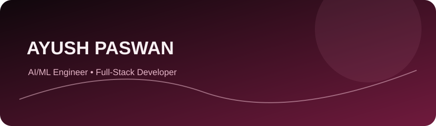

  

  

  <a href="https://github.com/ayushbabu12245-create">GitHub</a>
  &nbsp;·&nbsp;
  <a href="https://ayushpaswan.netlify.app/#">Portfolio</a>
  &nbsp;·&nbsp;
  <a href="https://www.linkedin.com/in/ayush-paswan-9bb315447/">LinkedIn</a>

## About

I’m **Ayush Paswan**, a Web Developer and Designer currently pursuing a **Diploma in Electrical Engineering** at **Govt. Polytechnic, Madhepura**. I enjoy building responsive frontend applications, e-commerce experiences, and interactive interfaces that make everyday tasks simpler.

My work combines frontend development with practical integrations, thoughtful layouts, and a focus on usability. I learn by building and improving real projects.

## Selected projects

### Campus Switch — Campus marketplace
A responsive, single-file campus marketplace designed to help college students exchange second-hand books, lab gear, and academic essentials. I contributed as the developer; the project was ideated by **Shivam Jha**.

### Vaste Mart — E-commerce platform
A multi-category e-commerce application with dynamic product showcases and a dedicated grocery area called the **Kirana Zone**, designed around localized shopping needs.

### Personal Cinematic Developer Portfolio
A personal portfolio showcasing web development work, with ambient gradients, interactive project showcases, and responsive layouts.

- [Open portfolio](https://ayushpaswan.netlify.app/#)

### Indian DJ Sound & R.K Photography — Web platforms
Business websites and mobile app interfaces for local media and photography services, including booking forms, EmailJS and Firebase integrations, and WhatsApp-based client communication.

> Individual source-code or demo URLs for Campus Switch, Vaste Mart, and the Indian DJ Sound / R.K Photography platforms were not included in the supplied resume, so I have not guessed project links. [Browse my public GitHub repositories](https://github.com/ayushbabu12245-create?tab=repositories).

## Technical skills

| Category | Verified skills and tools |
| --- | --- |
| **Frontend development** | HTML5, CSS3, JavaScript (ES6+), React, Vite, Tailwind CSS |
| **Tools & platforms** | Visual Studio Code, Git, GitHub, Netlify, Odoo, Firebase, EmailJS |
| **Development environments** | Windows Subsystem for Linux (WSL), Kali Linux, Termux, VirtualBox |
| **Core competencies** | Responsive web design, UI/UX prototyping, batch scripting, shell customization |

## Education

**Govt. Polytechnic, Madhepura**  
Diploma in Electrical Engineering · **2025 – Present** *(expected)*  
State Board of Technical Education (SBTE), Bihar

Relevant coursework and lab work include electrical measurements of DC and AC voltage/current using Moving Coil and Moving Iron analog meters, along with technical problem-solving.

## Academic participation

Participated in the Government of Bihar’s:

- **Srinivasa Ramanujan Talent Search Test** (Mathematics)
- **C.V. Raman Talent Search Test** (Science)

## GitHub contributions

The calendar below is an externally rendered view of the contribution activity available on my public GitHub profile. No contribution totals, streaks, or rankings are hard-coded here.

  

*GitHub statistics cards are omitted rather than showing metrics that have not been independently verified.*

## Find me online

- **GitHub:** [@ayushbabu12245-create](https://github.com/ayushbabu12245-create)
- **Portfolio:** [ayushpaswan.netlify.app](https://ayushpaswan.netlify.app/#)
- **LinkedIn:** [Ayush Paswan](https://www.linkedin.com/in/ayush-paswan-9bb315447/)

  

